<p align="center">
  
</p>

<p align="center">
  <i>Somewhere between a terminal and a viewfinder.</i>
</p>

<!-- Uncomment when the site goes public:
<p align="center"><a href="https://YOUR-SITE"><b>YOUR-SITE ↗</b></a></p>
-->

&nbsp;

### ✦ What NordStack is

NordStack is my corner of the internet: the things I build, the things I photograph, and whatever else I can't stop thinking about. It's mine first. Maybe a brand someday.

### ✦ Right now

```console
$ nordstack status
  building   →  the NordStack website
  shooting   →  the view from my window
  on repeat  →  Hey Ya! by OutKast
  chasing    →  3D modeling
```

### ✦ In my bag

- **Code**: React, Tailwind and TypeScript (still learning all three)
- **Camera**: Canon EOS 60D with the 18–55mm

&nbsp;

<p align="center">
  <sub>🧭 there's always something north</sub>
</p>
